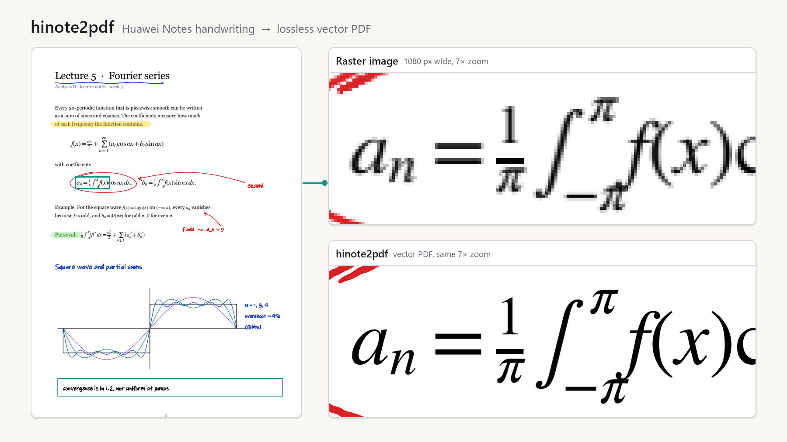
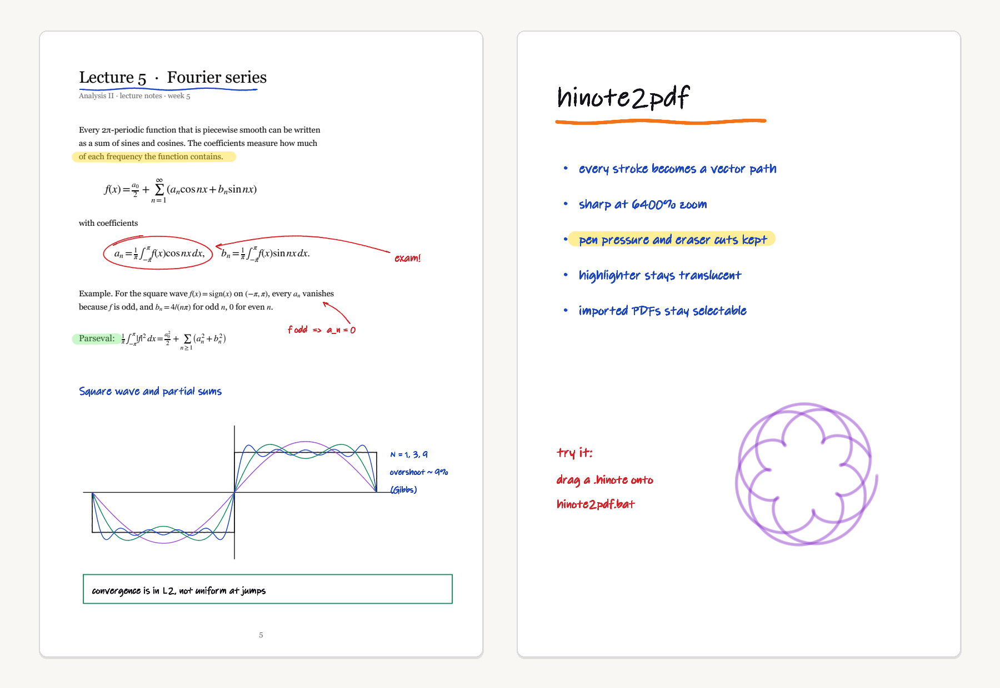
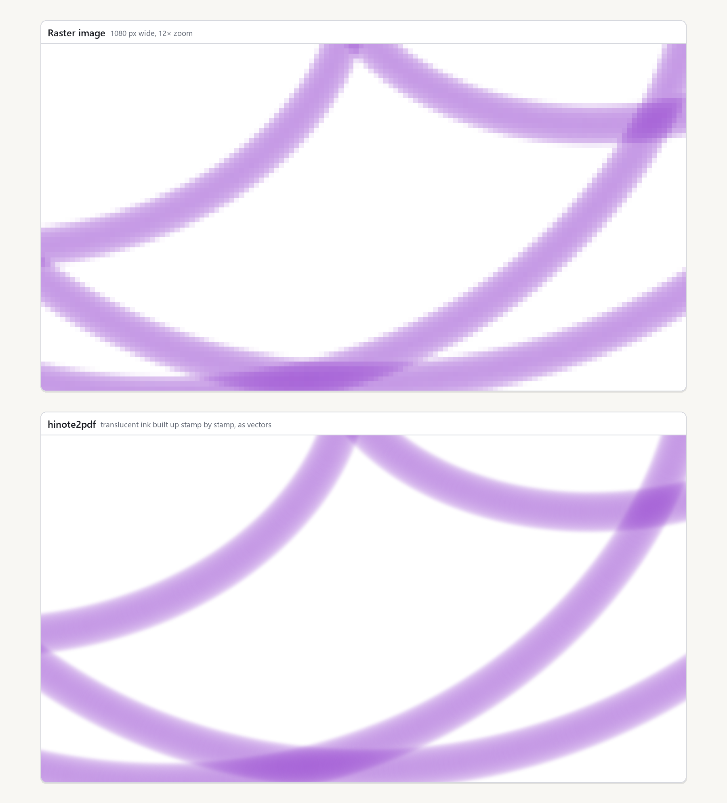

# hinote2pdf

**Turn your Huawei Notes handwriting into razor-sharp, lossless vector PDFs.**

Took your lecture notes with an M-Pencil on a MatePad? **hinote2pdf** converts the `.hinote`
files of Huawei Notes into PDFs in which every stroke is real vector geometry. The ink stays
sharp at any zoom, prints crisply and looks the way it did on your tablet: pen pressure,
colours, highlighters and eraser cuts included.



**[See a sample PDF](examples/sample.pdf)** (open it and zoom in as far as you like) ·
**[Project page](https://kahyaoglu20.github.io/projects/hinote2pdf/)**

## Why hinote2pdf?

Screenshots and pictures of handwritten pages are grids of pixels. They blur when you zoom in,
print fuzzy and can't be edited. hinote2pdf works from the strokes you actually wrote and
writes them as vector paths, so the PDF is exact at 100 % and at 6400 %.

- **Lossless vector ink.** Every pen, ballpoint, marker and highlighter stroke becomes PDF
  vector geometry at its exact position. Nothing is rasterised at any step.
- **Looks like your note.** Smooth curves through every pen sample, a width that follows your
  pen pressure, soft translucent pens that build up where strokes overlap, see-through
  highlighters and eraser cuts in exactly the right place.
- **Annotated PDFs stay PDFs.** If you wrote on top of an imported PDF (slides, a paper, a
  worksheet), that page is embedded unchanged under your ink, so its text stays sharp,
  selectable and searchable.
- **Editable ink if you want it.** `--annotations` turns each stroke into a standard PDF ink
  annotation that you can move or delete in Acrobat, Xodo, Drawboard and other editors.
- **Layers.** Handwriting and highlighter go on separate layers that you can switch on and off.
- **Private and offline.** It runs entirely on your computer. Nothing is uploaded, and your
  `.hinote` files are only read, never changed.
- **Drag and drop on Windows**, a command line everywhere, and whole folders at once.
- **Free and open source** under the MIT license.



## Quick start (Windows, no command line)

1. Install [Python 3.9 or newer](https://www.python.org/downloads/). In the installer, tick
   **"Add python.exe to PATH"**.
2. Download this repository (green **Code** button, then **Download ZIP**) and unzip it.
3. Open the unzipped folder, click the address bar, type `cmd`, press Enter and run
   `pip install -r requirements.txt` once.
4. Drag one or more `.hinote` files, or whole folders, onto **`hinote2pdf.bat`**. Each PDF
   appears next to its note. Double-clicking `hinote2pdf.bat` opens a file picker instead.

To get a note onto your computer, share or export it from Huawei Notes as a `.hinote` file
and move it over any way you like: Huawei Share, a USB cable, e-mail or a cloud drive.

## Command line (Windows, macOS, Linux)

```bash
pip install git+https://github.com/kahyaoglu20/hinote2pdf
hinote2pdf "my note.hinote"
```

From a downloaded copy, `python -m hinote2pdf "my note.hinote"` does the same. More examples:

```bash
hinote2pdf notes/ -o pdfs/                     # a whole folder, PDFs collected in pdfs/
hinote2pdf "my note.hinote" --annotations      # editable ink annotations
hinote2pdf "my note.hinote" --weight 1.3       # slightly bolder thin pens, like on screen
hinote2pdf "my note.hinote" --verify           # compare with the note's own page previews
```

| Option | Effect |
|---|---|
| `-o OUT` | output file, or a folder when converting several notes |
| `--annotations` | strokes become editable PDF **Ink annotations** (movable and deletable), each with its exact look |
| `--weight X` | scale every pen tip by X. 1 (default) is the true stroke geometry; about 1.3 matches how the tablet screen shows very thin pens, because screens round tiny tips up to whole pixels |
| `--polyline` | join the recorded pen samples with straight segments instead of a smooth curve |
| `--no-background` | ink only, without the imported PDF page |
| `--no-layers` | do not create the "Handwriting" and "Highlighter" layers |
| `--embed-source` | attach the original `.hinote` inside the PDF, so nothing is ever lost |
| `--dump-json` | also write every stroke and pen sample as JSON, for your own scripts |
| `--verify` | render each converted page and compare it with the preview stored in the note (needs `pip install pypdfium2 pillow`) |

## Try it without a tablet

[`examples/sample.hinote`](examples/sample.hinote) is a small two-page sample note: a typeset
lecture page annotated in handwriting with pens, arrows, a circle, highlighters and a sketch,
and a blank page with a marker underline and translucent ink.

```bash
python -m hinote2pdf examples/sample.hinote
```

The result is [`examples/sample.pdf`](examples/sample.pdf). Its lecture text is still
selectable, and the ink is vector all the way down:



## How faithful is it?

You can check for yourself. `--verify` renders each converted page and compares it with the
page preview that Huawei Notes keeps inside every note, then reports how much of the
handwriting the PDF reproduces. On a real 15-page handwritten note, every page scored
**83–87 %** at the default weight and **89–93 %** with `--weight 1.3`. Most of the remaining
difference comes from the previews themselves: they are small pixel images in which thin
strokes are rounded up to whole pixels and look bolder than they really are.

**Fully supported:** pen, ballpoint, marker and highlighter; freehand strokes, straight lines,
rectangles and eraser cuts; imported-PDF backgrounds; blank and coloured paper.

**Approximated:** the pencil and the painting brushes have a grainy texture that a vector PDF
can't express exactly. They are drawn with the tip's averaged shape, and the converter says so.

**Not yet:** lined, dotted and grid paper patterns (the paper colour is kept), and typed text
boxes or inserted images. The converter prints a warning when a note contains them.

## FAQ

**Do I need a Huawei account or an internet connection?** No. Everything happens locally.

**Will it change my notes?** No. The `.hinote` file is only read.

**How big are the PDFs?** Vector ink is detailed. Expect roughly 1–3 MB per densely written
page.

**Something didn't convert right?** Please [open an issue](https://github.com/kahyaoglu20/hinote2pdf/issues)
with the converter's output. If you are comfortable sharing it, a note that shows the problem
helps a lot.

## Disclaimer

hinote2pdf is an independent, unofficial open-source tool for converting your own notes. It is
not affiliated with, authorised, endorsed or sponsored by Huawei. Huawei, Huawei Notes,
MatePad and M-Pencil are trademarks of Huawei Technologies Co., Ltd. and are used here only to
describe compatibility.

## License

[MIT](LICENSE) © 2026 Ömer Kahyaoğlu
